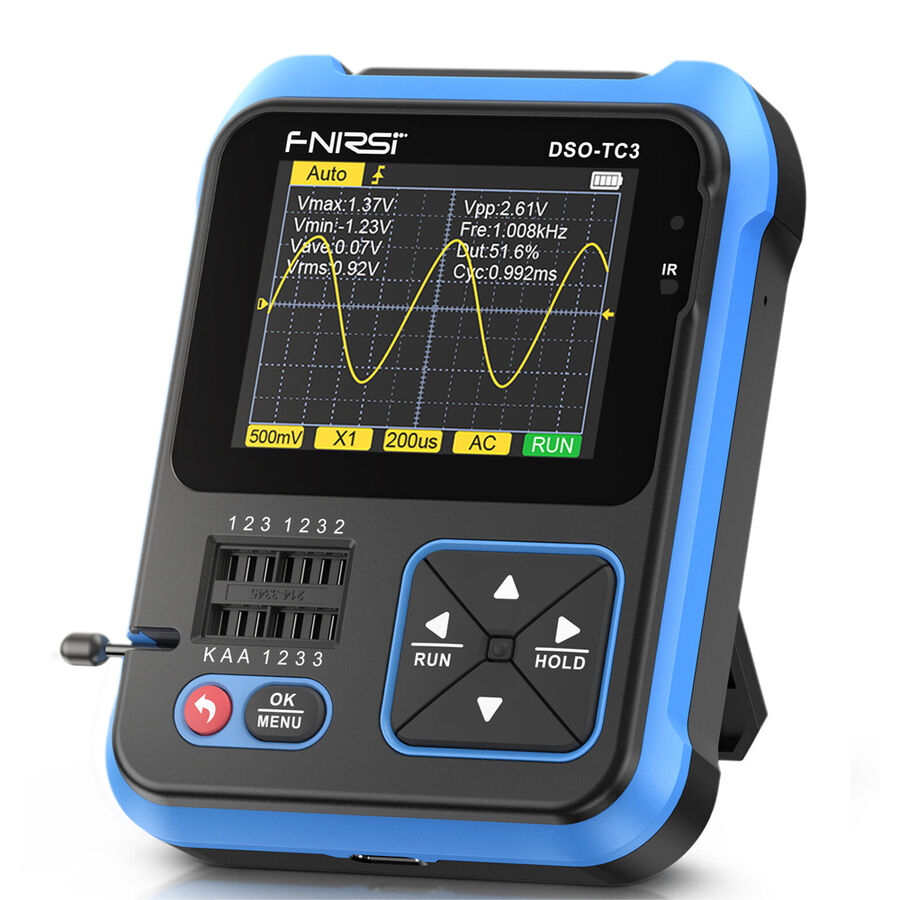

<p align="center">
  
</p>

# FNIRSI DSO-TC3 PC v1.0

[Türkçe](#türkçe) · [English](#english) · [Downloads / İndir](https://github.com/Acalitoss/fnirsi-tc3-pc/releases/latest)

<p align="center"></p>

## Çoklu mod geliştirme sürümü / Multi-mode development build

**v1.1-dev** kaynak kodu ve yerel EXE, dört ana bölüm arasında cihazla eş zamanlı geçişi destekler. Bu geliştirme sürümü, v1.0 Release paketinden farklıdır ve **protokol 3 firmware** gerektirir. Eski firmware ile çoklu mod komutları gönderilmez.

- Ana menü: M-Tester, Osiloskop, Generator, Tools; mod değişikliği cihazdan geri okunur.
- Generator: Sine, Square, Pulse, Triangle, Ramp, DC; cihazın frekans, genlik ve görev oranını gösterir. Yön tuşları alan/basamak ve değer değiştirir. 5 kHz → 6 kHz → 5 kHz değişimi doğrulandı; çıkış dalgasının elektriksel doğruluğu ayrıca ölçülmedi.
- Tools: ON-OFF, Voltage, DS18B20, DHT11, IR Decode, Calibrate seçimi. Voltaj/sensör/IR alanları cihazdan okunur. Sensör doğruluğu ve kalibrasyon işlemi fiziksel doğrulamadan geçmedi. Devamlılık, standart test soketi ve cihaz sesini kullanır; 0–40 V girişine taşınmadı.
- M-Tester: OK/Test başlatma, tür ve pin okuma; direnç, kapasitör, bobin, diyot, pil, zener ve BJT için çözümlenen sayısal alanlar. Diğer türlerin ayrıntıları cihaz ekranından izlenir. Bilinen elemanlarla kapsamlı ölçüm doğrulaması bekleniyor.
- Ortak OK, geri ve dört yön tuşu; osiloskopta AUTO, tetik kenarı ve mevcut ölçek/zoom kontrolleri.

Build `scripts/build_windows.py` now produces the **v1.1-dev** EXE with the protocol 3 patch. The standalone application can switch between the four device modes and operate the native direction/OK/back keys. Mode transitions, all six generator selections and a reversible frequency change were verified on one physical device. Tools selection works; sensor accuracy and calibration remain unverified. M-Tester result decoding is partial; details for unsupported types remain on the device screen. Continuity still uses the standard test socket and device buzzer, not the 0–40 V input. Power control and long-OK calibration are not exposed remotely.

Build patch: `python scripts/build_patch_v3.py --firmware vendor/DSO-TC3_V0.3.s19`. Output: `build/v3/`. Protocol 3 SHA-256: `8122bd0b8f564c4ce08cd9eecb78c70c3cbcacf15d2beb5cfb8db8d2402146eb`.

## Türkçe

Windows için Releases sayfasındaki EXE dosyasını indirin; Python kurulumu gerekmez. USB üzerinden bağlanın. Stok cihazda önce **Firmware kur** düğmesiyle desteklenen yamayı yükleyin (▼ + güç: Bootloader OK); yüklemeden sonra cihazı açıp osiloskop ekranına geçin. EXE yamayı içerir; ayrı `.s19` ve `SHA256SUMS.txt` dosyaları da sürüme eklenir.

Üst menüden **Türkçe / English** seçilebilir; dil tercihi saklanır.

**Zoom:** X/Y +/− düğmeleri, fare tekerleği (X), Shift + tekerlek (Y), sürükleyerek kaydırma ve çift tıklayarak sıfırlama. **Dalgalanmayı ortala** küçük değişimleri ortalayıp büyütür. Sabit kareyi incelemek için PC duraklatmayı kullanın. Zoom yeni örnek üretmez, cihaz çözünürlüğünü artırmaz ve cihaz ölçek ayarlarını değiştirmez.

**Tools ve 0–40 V girişinden devamlılık ölçümü v1.0 içinde desteklenmez.** Bu girişte gerçek devamlılık ölçümü için test akımı ve donanım yolu ayrıca doğrulanmalıdır; yalnızca gerilim okumasından devamlılık sonucu çıkarılmaz.

DSO-TC3 V0.3 için deneysel PC osiloskop arayüzü ve USB firmware yaması. Python/Tkinter arayüzü cihazın ekran düzenini izler; ölçüm değerlerini doğrudan cihazdan okur ve ayar değişikliklerini cihazdan geri okuyarak doğrular.

**Durum: erken deneysel sürüm.** Bir Windows bilgisayar ve bir DSO-TC3 V0.3 üzerinde test edildi. FNIRSI'nin resmî yazılımı değildir. Firmware değiştirmek cihazı çalışmaz hâle getirebilir. Voltaj ölçümleri bağımsız bir ölçüm cihazına göre kalibre edilmiş değildir.

## Özellikler

- USB üzerinden 600 imzalı örnek sözcüğünü okuma; cihazın tetik konumuna göre 300 noktalı görünüm.
- Cihazın Vmax, Vmin, Vavg, Vrms, Vpp, frekans, görev oranı ve periyot alanlarını görüntüleme.
- V/div, prob, zaman tabanı, AC/DC ve tetik ayarları için PC kontrolleri.
- Cihaz RUN/HOLD kontrolü ve CSV dışa aktarma.
- Orijinal üretici dosyasından yeniden üretilebilen firmware yaması; depoda üretici firmware'i bulunmaz.

Gerçek cihazda doğrulanan kontroller: **V/div, zaman tabanı ve RUN/HOLD**. Diğer kontroller uygulanmıştır ancak aynı kapsamda fiziksel doğrulamadan geçmemiştir.

## PC uygulamasını kurma

Python 3.10 veya üstü ve Tkinter gerekir. Windows Python kurulumunda Tcl/Tk bileşenini seçin. Depo klasöründe:

```powershell
python -m venv .venv
.\.venv\Scripts\Activate.ps1
python -m pip install -e .
python -m fnirsi_tc3 --connect
```

Alternatif: `fnirsi-tc3 --connect`. Arayüzde doğru seri portu seçin; örnek cihaz COM7 olarak tanındı. Uygulama arayüzünde Türkçe ve İngilizce seçilebilir.

**Stok V0.3 firmware canlı ölçüm ve PC kontrolünü desteklemez.** Bu işlevler aşağıdaki deneysel yamanın cihaza yüklenmesini gerektirir. Uygulama stok cihazdan yalnızca mevcut yapılandırma sorgusunu okuyabilir.

## Firmware yamasını oluşturma

1. Üreticinin [indirme sayfasından](https://www.fnirsi.com/pages/manuals-firmwares) DSO-TC3 Firmware V0.3 paketini indirin ve çıkarın.
2. Bağımlılıkları yükleyin ve `.s19` dosyasını girdi olarak verin:

```powershell
python -m pip install -e ".[firmware]"
python scripts/build_patch.py --firmware "vendor/DSO-TC3_V0.3.s19"
```

Oluşturucu yalnızca SHA-256 değeri `9a97d5bb1a5864af6484b92f115ae827e16e3972f5ec8828362c358ba2430b61` olan dosyayı kabul eder. Başka sürüm veya donanım revizyonuna zorlamayın. Çıktılar `build/` içinde oluşur ve Git tarafından dışlanır.

Oluşturulan dosya SHA-256: `97c601b5c02b2169e51275a6b5e7328f2919d3101c6a53bbdf8807274eb5c5ac`.

## Yükleme

Önce orijinal V0.3 dosyasını saklayın. PC görüntüleyicisini kapatın. Cihazı kapatıp **▼ + güç** ile `Bootloader OK` ekranına geçin. Depo kökünde:

```powershell
python scripts/flash.py --image build/DSO-TC3_V0.3_USB_EXPERIMENTAL.s19
```

Yükleyici USB kimliği `19F5:5740` olan tek cihazı seçer. Gerekirse `--port COM7` belirtin. Stok yapılandırma yanıtını bootloader yanıtı olarak kabul etmez. Tüm paketler onaylansa bile açılış ve ölçüm doğrulaması ayrıca gereklidir.

Yüklemeden sonra güç tuşuyla açıp osiloskop ekranına geçin. Ardından PC uygulamasını başlatın. Kurtarma için bootloader açılabiliyorsa aynı yükleyiciye orijinal üretici `.s19` dosyası verilebilir.

## Kullanım ve sınırlar

Alt ölçek kutularına tıklayın veya seçim listelerinden ayar değiştirin. PC, cihazın tuş olayını işlemesini bekler ve ayarı geri okur; yalnızca komut onayını başarı saymaz. PC duraklatma düğmesi yalnızca görüntüleyiciyi durdurur; alt RUN/HOLD kutusu cihazın durumunu değiştirir.

- Gerilim rakamları DSO-TC3'ün hesapladığı değerlerdir; laboratuvar güç kaynağının ayarı değildir. Güç kaynağı bu uygulamaya bağlı veya uygulama tarafından kontrol ediliyor değildir.
- Örnek sözcükleri ham ADC kodu değil, firmware'in hesapladığı ekran düşey yer değiştirme değerleridir. CSV bunları `display_displacement` olarak saklar.
- Sayfalar ardışık okunur; atomik kare aktarımı yoktur. Tutarlı durağan kayıt için cihaz HOLD kullanılabilir.
- Yüksek frekanslı AC doğruluğu, frekans/görev ölçümleri ve gecikme sınırları bağımsız olarak doğrulanmadı.
- Firmware paketinin dış doğrulama alanları tamamen çözülemedi; orijinal başlık korunur. Yama bu tek cihazda başarıyla yüklenip çalıştırıldı.

## Geliştirme ve test

```powershell
python -m unittest discover -s tests -v
```

Donanım gerektirmeyen testler paket ayrıştırmasını, işaretli örnekleri, ölçüm ofsetlerini ve aktarım çerçevelerini kontrol eder. GitHub Actions bu testleri Windows ve Linux'ta çalıştırır; bu, Linux üzerinde gerçek cihaz desteğinin doğrulandığı anlamına gelmez.

Firmware testleri için üretici dosyası ve ek bağımlılıklar gerekir:

```powershell
$env:TC3_STOCK_FIRMWARE = (Resolve-Path 'vendor/DSO-TC3_V0.3.s19').Path
python -m unittest discover -s tests -v
```

[Protokol ve bellek haritası](docs/PROTOCOL.md) · [Katkı yönergeleri](CONTRIBUTING.md) · [Lisans](LICENSE)

MIT lisansı yalnızca bu projedeki koda uygulanır. FNIRSI firmware'i, güncelleme programı, marka ve ürün adları kendi hak sahiplerine aittir.


## English

Experimental USB oscilloscope interface and firmware patch for **FNIRSI DSO-TC3 V0.3**. This is an independent project, tested on one Windows computer and one device. Modifying firmware can make the device unusable. Voltage accuracy has not been independently calibrated.

### Windows quick start

1. Download the standalone Windows x64 EXE from [Releases](https://github.com/Acalitoss/fnirsi-tc3-pc/releases/latest). No Python installation is required.
2. Connect the supported device by USB. For stock firmware, select **Install firmware** in the app; power off the device and hold **▼ + power** to enter `Bootloader OK`. Keep the original vendor firmware for recovery.
3. After upload, power on the device and open its oscilloscope screen. The app detects a single supported USB device automatically.
4. Choose **English** or **Türkçe** in the toolbar. The preference is saved.

The EXE includes the verified patch. A separate patched `.s19` file and SHA-256 checksums are provided as release assets. Stock firmware cannot stream waveform data or accept these PC controls.

### Features and zoom

- Read 600 signed display displacement words and display the device's trigger-selected 300-point window.
- Show the device's Vmax, Vmin, Vavg, Vrms, Vpp, frequency, duty cycle and period.
- Adjust V/div, probe, timebase, AC/DC and trigger; read settings back from the device.
- Device RUN/HOLD, separate PC pause and CSV export.
- X/Y zoom buttons; mouse wheel for horizontal zoom, Shift + wheel for vertical zoom. Drag to pan; double-click or Reset view to reset. Centre ripple centres and magnifies small changes. Pause the PC view for detailed inspection.

Zoom changes the PC view only. It does not add samples, increase measurement resolution or change device settings. Hardware-verified controls are **V/div, timebase and RUN/HOLD**; the remaining controls have not received equivalent physical validation.

### Limitations

Tools and continuity testing through the **0–40 V input are not supported in v1.0**. The required test current and hardware path still need validation. Voltage readings alone cannot establish continuity.

Displayed voltages are calculated by the DSO-TC3, not read from or controlled on the laboratory power supply. Sample words are display displacements, not raw ADC codes; CSV uses `display_displacement`. Pages are read sequentially without an atomic frame snapshot; use device HOLD for a stable capture. High-frequency accuracy and frequency/duty measurements have not been independently verified.

### Build from source

Requires Python 3.10+ and Tkinter:

```powershell
python -m pip install -e ".[firmware,dev]"
python -m fnirsi_tc3
python -m unittest discover -s tests -v
python scripts/build_patch.py --firmware "vendor/DSO-TC3_V0.3.s19"
```

On Windows, install PyInstaller and build the standalone app:

```powershell
python -m pip install pyinstaller
python scripts/build_windows.py --firmware "vendor/DSO-TC3_V0.3.s19"
```

The patch builder accepts only stock SHA-256 `9a97d5bb1a5864af6484b92f115ae827e16e3972f5ec8828362c358ba2430b61`. The resulting patched SHA-256 is `97c601b5c02b2169e51275a6b5e7328f2919d3101c6a53bbdf8807274eb5c5ac`. Never force this patch onto another firmware or hardware revision. To run the firmware emulation tests, set `TC3_STOCK_FIRMWARE` to the original vendor file path.

For command-line upload, close the viewer, enter `Bootloader OK` and run `python scripts/flash.py --image build/DSO-TC3_V0.3_USB_EXPERIMENTAL.s19`. If the bootloader remains accessible, the same tool can upload the original supported vendor image for recovery.

[Protocol](docs/PROTOCOL.md) · [Contributing](CONTRIBUTING.md) · [License](LICENSE)

The MIT license covers project code only. Vendor firmware and brand assets remain the property of their respective rights holders. This is not official FNIRSI software.
